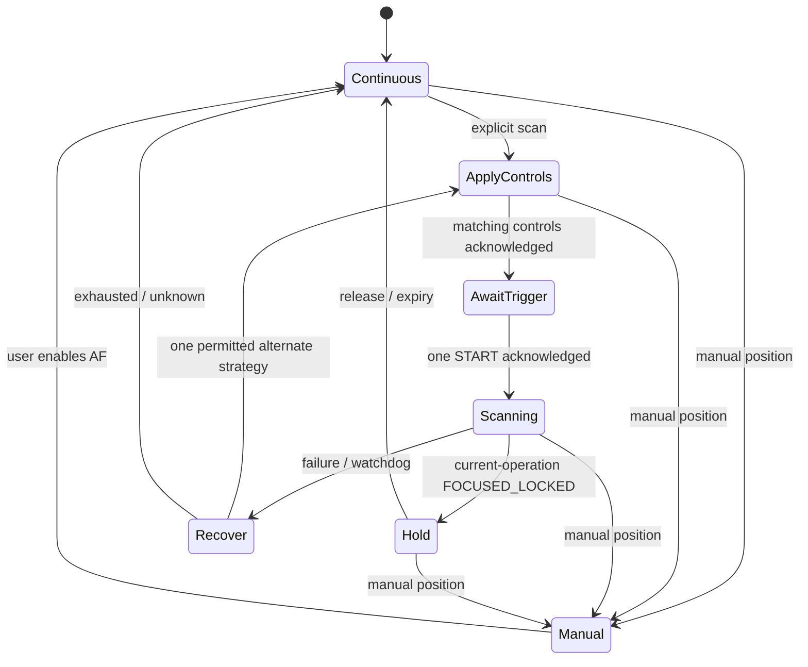

# Autofocus redesign: research, audit, and implementation plan

Date: 2026-10-29. Branch: `fix/mtk-continuous-picture-tap-focus`.
Status: research and proposed implementation; this document does not implement the redesign.

## Decision

Build one request-aware autofocus controller with separate policies for continuous tracking, a requested scan, and a confirmed lock. Keep hardware continuous-picture for photo and continuous-video for video when they work. Use AUTO for an explicit new scan when needed, then reliably return to the user's continuous mode. Add measured, narrowly scoped recovery for defective routes. Develop software contrast AF as the last fallback on cameras that actually support manual lens positioning.

There is no public Camera2 command that guarantees a fresh continuous-picture sweep on every HAL. START in that mode can lock an existing passive result. The compatibility objective must be: correct behavior on conforming HALs; bounded recovery and accurate status on defective ones; software focusing when the necessary lens controls work; honest unsupported/manual-only behavior otherwise. Neither an app rewrite nor a paper can guarantee autofocus on a fixed-focus lens, an unresponsive actuator, or firmware that supplies no usable control. [Android 3A][android-3a], [request controls][request]

This is a broad primary-source review, not a claim to have exhausted every resource online. Sources include current and older CameraX implementations, CameraPipe, CTS/ITS, Open Camera, PhotonCamera, GrapheneOS Camera, LineageOS Aperture, Raspberry Pi/libcamera, Xiaomi documentation, and five relevant research papers. Branches are moving targets; the companion [source inventory](autofocus-source-inventory.json) records downloaded source hashes and available revisions.

## 1. What the evidence actually establishes

### Android's contract

| Finding | Consequence for RawLens |
|---|---|
| Continuous-picture START can finish an ongoing passive scan or lock the existing verdict. Continuous-video START locks immediately. | A forced new scan, continuous tracking, and locking must be different operations. |
| A non-IDLE trigger is a separate event on each request. | Repeating requests always carry IDLE. START/CANCEL are discrete submissions. |
| A mode change resets AF; configuring streams alone does not necessarily reset 3A. | Preserve or intentionally release a lock across session transitions; never depend on reconfiguration as an implicit reset. |
| AF with AE_OFF is device-dependent. | Test PROGRAM/manual exposure separately. Do not conclude that one AE_ON trigger frame enables AF for an AE_OFF repeating stream. |
| AF regions and focus distance have capability and coordinate-system rules. Uncalibrated focus values are not necessarily physical diopters. | Separate actuator/AF capability from region capability; use calibration-aware telemetry and geometry. |

These are constraints, not recipes that repair broken firmware. [Android 3A][android-3a], [CaptureRequest][request], [CameraCharacteristics][characteristics], [MeteringRectangle][metering]

### What other implementations contribute

| Source inspected | Useful practice | What it does not prove |
|---|---|---|
| CameraX current `impl/FocusMeteringControl.kt` and CameraPipe `Controller3A.kt` | Separate metering, triggering, locks, cancellation, and timeouts. Explicit focus actions select AUTO. Current code also supplies an AE_ON override for the AF trigger. | That AE_ON for a single frame solves every manual-exposure HAL; that API completion independently proves optical sharpness. |
| CameraX older `internal/FocusMeteringControl.java` | Session-update identity gates completion; cancellation waits for the desired mode/update. | That the older requirement to see ACTIVE_SCAN should be copied literally: legal transitions can be skipped between reported frames. |
| AOSP CTS `Camera2Focuser` | Distinguishes touch/forced active focus from opportunistic capture lock; increments an AF-run identity; rejects old runs and non-increasing frames; inspects partial results. | That a metadata-based conformance test is a complete optical quality test. |
| Open Camera `Preview.java` plus `CameraController2.java` | Photo touch in continuous mode temporarily uses AUTO, then restores continuous; its controller can avoid START when simply waiting for passive AF. Continuous and touch behavior exist at different layers. | That RawLens's comment calling its code an Open Camera port makes all current RawLens choices equivalent to upstream. |
| PhotonCamera current `dev` touch-focus implementation | Request/region membership, bounded cancel/start acknowledgments, passive dwell, session fallback, and distinction between unacknowledged and failed commands. | That its current experimental branch, timing constants, or device behavior are validated for all RawLens sessions. |
| GrapheneOS Camera | Uses CameraX focus/metering actions, preview metering-point mapping, and configurable auto-cancel. | A hidden continuous-only force-sweep API. |
| LineageOS Aperture | Uses the CameraX camera-controller focus state rather than maintaining a second independent Camera2 AF state machine in the activity. | A firmware-independent replacement AF algorithm. |
| libcamera Raspberry Pi AF | Separate coarse/fine/settle phases, confidence, step/frame delays, hysteresis/retrigger controls, and lens-specific tuning. | A drop-in Android implementation: it runs below the application layer with statistics and hardware knowledge RawLens may not receive. |

Sources: [CameraX current][camerax], [CameraPipe][camerapipe], [CameraX older][camerax-old], [CTS focuser][cts], [Open Camera preview][oc-preview], [Open Camera controller][oc-controller], [PhotonCamera][photon], [GrapheneOS][graphene], [Aperture][aperture], [libcamera AF][libcamera].

CameraX also contains a concrete Samsung front-camera AF-region correction limited to Android versions before 13. That is a good model for a narrow, versioned quirk, not a reason to mirror every device's AF region. [CameraX region quirk][region-quirk]

Xiaomi recommends touch regions and CANCEL→START→IDLE, continuous-picture for preview, and continuous-video for video. This supports testing that sequence, but cannot override the standard continuous-mode lock semantics. [Xiaomi 3A guide][xiaomi]

### What the papers change in the design

| Research | Practical implication | Limit |
|---|---|---|
| Pertuz et al., *Analysis of focus measure operators for shape-from-focus* (2013) | Benchmark candidate focus scores against noise, contrast, clipping, and ROI size rather than choosing one universal threshold. | Shape-from-focus experiments do not directly validate live smartphone AF. |
| Pertuz et al., *Reliability measure for shape-from-focus* (2013) | A focus peak needs confidence; flat or inconsistent focus curves must be allowed to return unknown. | Its exact reliability model needs testing before use on phone imagery. |
| Abuolaim et al., *Revisiting Autofocus for Smartphone Cameras* (ECCV 2018) | Evaluate target selection, temporal behavior, lens-motion cost, and hunting, not just maximum sharpness in one frame. | Research datasets are not a Camera2 HAL compatibility suite. |
| Herrmann et al., *Learning to Autofocus* (CVPR 2020) | Learned focus prediction is possible, including use of focal stacks and dual-pixel data; focal breathing can confuse contrast baselines. | Training/calibration and suitable input data are prerequisites. Ordinary RAW does not establish access to separated dual-pixel views. |
| Choi et al., *Exploring Positional Characteristics of Dual-Pixel Data for Camera Autofocus* (ICCV 2023) | ROI position and lens position affect learned AF accuracy; cross-lens generalization cannot be assumed. | A dual-pixel model is not a generic Camera2 workaround. |

Sources: [focus-measure analysis][pertuz], [reliability paper][reliability], [smartphone AF][revisiting], [learning AF][learning], [positional dual-pixel AF][positional]. No learned model is proposed for the first implementation.

### Limits of our previous device investigation

The [62-trial report](results/mtk-continuous-af-2026-10-29/README.md) demonstrates metadata-reported motion on connected model `25080RABDG` (`lapis`), including a RAW+YUV stream. It does not establish behavior on the Xiaomi 14T Pro or every MediaTek HAL. Comments and earlier logs about other devices are separate evidence.

Cold trials reset the lens before each sequence; they cannot isolate CANCEL as the cause of motion. Warm trials largely retap the same region; little movement can be correct if that subject is already focused. They did not record a timestamp-matched optical focus score or controlled near/far target transitions. Therefore neither “AF is definitely broken” nor “AF is definitely fixed” follows from a distance range alone. Keep those trials as preliminary diagnostics and replace their acceptance criteria below.

## 2. Audit of the current RawLens code

The worktree is actively changing. These findings refer to function names and the files inspected on this date; verify them against the implementation snapshot before editing.

| Priority | Finding | Required change |
|---|---|---|
| P0 | `TouchFocus.start` returns metering-only when `maxAfRegions()==0`. Zero regions says the app cannot select an AF ROI; it does not by itself mean no autofocus. This branch also writes AE for an AF-only gesture because it does not gate the AE-region write on `updateAe`. | Separate `canAutofocus`, `canTrigger`, `canSetAfRegion`, and `canSetAeRegion`. Offer a global scan where AF exists without regions, and respect AF-only input. |
| P0 | `onAfState` receives state and distance without request identity, actual AF mode, frame number, or session generation. The pre-START guard fixed earlier is useful, but old results can still arrive after START and satisfy time floors. | Pass a complete AF observation and enforce session, operation, revision, mode, and frame barriers. |
| P0 | The shared `debugCaptureCallback` forwards one-shot results without an explicit session/generation guard in that callback. | Reject obsolete session/operation results before they touch AF, exposure, flash waiters, or UI. |
| P0 | `isLockSuccess` equates PASSIVE_FOCUSED with FOCUSED_LOCKED. `onContinuousTapState` publishes a lock while a timed tap keeps tracking; an indefinite hold publishes before its locking START has been confirmed. | Represent focused, tracking, lock requested, lock confirmed, and unknown separately. |
| P0 | A late passive-focused result can upgrade a completed failure without proving it belongs to the failed operation. A failed indefinite hold calls `onFocusLock(true, ...)`, conflating an AE hold with an AF lock. | Operation-bound late completion; independent AF and AE status. |
| P0 | A single failed AUTO cycle with scan metadata and no reported distance change permanently stores `dead_<cameraId>`. | Replace with scoped, reversible evidence; no permanent hardware verdict from one scene. |
| P1 | `START_SETTLE_MS=60`, elapsed floors, and INACTIVE grace stand in for request application. `scanSeen` accepts either scan state without checking mode. | Use request acknowledgments and mode-specific transitions; time bounds remain watchdogs only. |
| P1 | `sendAfTrigger` forces AE_ON only when `dynamicExposureSettings.enabled`; it does not describe a complete focus exposure policy and may differ from repeating controls. | Give exposure ownership explicit rules for hardware AE, PROGRAM, user manual, flash, and restoration. |
| P1 | `supportsTouchTrigger` checks only AUTO; `defaultAfMode` puts continuous-video after AUTO/MACRO/EDOF. | Capability-aware idle and scan selections; continuous-video is a better continuous fallback than idle AUTO. Never trigger EDOF as if it were a scanning lens. |
| P1 | `needsIdleScanNudge` is described as occasional AF, but its calls only nudge AUTO-only idle at startup/release. | If AUTO-only AF-C is required, add scene-driven refocusing with hysteresis and a budget; call it assisted continuous AF. |
| P1 | Touch taps route through the photo controller; its no-photo-session branch intentionally ignores video taps. Video AF selection lives in `VideoManualControls`, and its AUTO fallback has no corresponding trigger in that helper. | Reuse the AF policy through recorder session adapters; explicitly support or report unsupported video tap/trigger behavior. |
| P1 | `meteringRegion` normalizes over the entire view, uses sensor rotation/mirroring and crop bounds, but does not explicitly receive the renderer's full content/crop transform. | Audit actual RAW/BGU content transforms before declaring geometry wrong; then use one inverse display transform including crop, zoom, distortion mode, aspect fit/fill, rotation, and mirroring. |
| P1 | `SessionEvidence.working` is any non-INACTIVE state or distance change, not optical proof. `LENS_MOVED_EPSILON_D=0.02` assumes meaningful comparable units. | Rename weak evidence accurately; reject NaN/infinity; account for uncalibrated/quantized metadata. Keep route-discovery AF/AWB inference separate from tap-strategy learning. |
| P2 | Several booleans plus timeout, reset, pending-start, idle-nudge, and kick callbacks encode overlapping states. | Introduce a pure reducer with typed states/events/effects and an injected clock. |

Main files: `TouchFocus.kt`, `AutoFocusPolicy.kt`, `RawCameraController.kt`, `VideoManualControls.kt`, `RawViewfinder.kt`, `BguGeometry.kt`, `AfTrace.kt`, `FocusPeaking.kt`, and their tests. The newly guarded startup recovery in the current worktree should be preserved; do not reintroduce unconditional startup kicks.

## 3. Proposed behavior

### Independent user intents

| Intent | Behavior |
|---|---|
| Photo AF-C, no selected target | CONTINUOUS_PICTURE with IDLE; scene/face policy owns the default region. No periodic reset on a healthy static scene. |
| Photo AF-C, selected target (recommended default tap) | Keep continuous AF on that region. Retarget/release prior lock with a bounded CANCEL where needed. If the new target demonstrably fails to reacquire, perform one bounded AUTO scan and return to continuous with the target retained. UI says tracking/focused, not locked. |
| Explicit single-focus/timed-lock action | Start a new AUTO scan on the target, confirm its result, hold for the configured duration, then cancel and restore the prior continuous mode. Keep the existing timed tap-lock behavior available as a distinct interaction policy; it must not silently turn AF-C into a ten-second lock. |
| Long press | Request AF lock and optional AE hold. Show each only when its own condition is confirmed; an AF miss does not prevent an explicitly requested AE hold. |
| Same-place deliberate retap | New operation identity; cancel obsolete work and run the requested action again. Suppress only true input bounce. |
| AF-only drag | Latest target wins; coalesce high-frequency moves while dragging; do not move AE or restart an expensive scan for every motion event. Commit/refocus at a bounded rate or release. |
| Manual focus | Cancel AF operations and watchdogs; AF_OFF with clamped valid manual position; AF must not steal the lens back. |
| Fixed focus / no working lens control | Meter where supported, report fixed focus/unsupported AF, avoid a fake focused-lock badge. |
| Video AF-C | CONTINUOUS_VIDEO where available. Tap-to-track can remain continuous; an explicit new scan may briefly use AUTO only if the session supports it. |

Keep target-retention duration separate from lock duration. A successful AUTO reacquisition for an AF-C tap returns to continuous promptly instead of inheriting the existing ten-second lock timer.

A selected image coordinate is not an object tracker. Continuous tracking on the region means focusing on the content at that region; following a moving object needs a separate tracker with confidence and target-loss policy.

### Request/result protocol

Proposed observation:

```text
AfObservation {
  sessionGeneration, operationId, controlsRevision,
  frameNumber, sensorTimestamp, requestKind,
  requestedMode, actualMode, requestedRegion, resultRegion?,
  afState?, lensState?, focusPosition?,
  actualAeMode?, exposureTime?, sensitivity?, activePhysicalCameraId?
}
```

Proposed flow:



Implementation rules:

1. Allocate a session generation and operation ID. Retap/manual/lens switch/stop invalidates old effects immediately. All effects run on the camera executor.
2. Apply one immutable controls snapshot to repeating and trigger requests: mode, regions, face priority, exposure policy, zoom/crop, and session route. CANCEL an old lock/scan when required; the first scan after a known clean state need not add a gratuitous CANCEL.
3. Observe a matching controls revision/result before starting a hardware-dependent settle phase. An acknowledged request proves application of that request, not that the optics are settled.
4. Submit START once with the same intended mode/region. Obtain the trigger's frame identity from callbacks. Do not accept results preceding it, from another operation, or from an incompatible mode.
5. Accept legitimate immediate locked results when identity proves they follow this trigger; do not require ACTIVE_SCAN to have been reported. Conversely, seeing ACTIVE_SCAN alone is not success or proof of movement.
6. For explicit AUTO lock, success is FOCUSED_LOCKED; NOT_FOCUSED_LOCKED is an executed but unsuccessful action. For continuous tracking, PASSIVE_FOCUSED is a focused observation, not a held lock.
7. Handle partial and total results deterministically. Use total results initially; add partial-result latency reduction only with one coherent per-frame merge and no duplicate state transitions.
8. Release with a bounded protocol: CANCEL where applicable, restore the desired idle mode/regions/exposure, and observe restoration. Report restoring/unknown on missing acknowledgment instead of silently claiming AF-C is back.
9. Keep a wall-clock operation deadline even if frames stop; use frame progress and measured exposure/frame duration for subsidiary watchdogs. Budget all retries under the original operation deadline.
10. Preserve the RAW pipeline: existing `request.tag == true` uses identify RAW/ZSL frames. A structured request tag must retain that information and update every consumer, or use a separate request-identity registry during migration.

Proposed components: `AfController` (reducer), `AfRequestBridge` (session adapter), `AfCapabilities`, `AfStrategyPolicy`, `AfHealthMonitor`, and `AfTelemetry`. Avoid replacing the entire camera session layer or migrating to CameraX just to obtain these practices.

### Exposure and continuous-AF health

Start with the current exposure unchanged. A HAL quirk may permit a short hardware-AE focus window, but it must cover the actual scan rather than a guessed single-frame pulse if experiments establish that need. Preserve user-manual exposure by default; never silently abandon it for AF. If borrowing AE is offered, make the policy explicit and restore it on success, failure, retap, manual takeover, close, and capture interruption.

Coordinate with PROGRAM/ETTR and flash; do not let a borrowed AE frame rewrite the user's selected exposure or contaminate the RAW ZSL ring. Preserve explicit AE lock ownership. Where continuous AF only works with hardware AE, the choices are hardware-AE preview, assisted AF, or software AF—not a promise that AF-C plus AE_OFF is universally supported.

The health monitor must combine current target/scene change, metadata progress, an ROI image-quality trend, and frame delivery. A stationary focused lens is healthy. A textureless or dark target is an ambiguous scene, not evidence of a dead HAL. Recovery starts only when there is a reason to expect reacquisition and evidence that it is not happening; it never interrupts manual focus, confirmed hold, capture/burst, or a progressing scan.

Recovery order is scoped by route evidence: continuous region/CANCEL → explicit AUTO scan → one validated alternative/reset → optional software AF → useful unknown/manual status. Do not try every mode on every tap. Do not reset sessions while recording unless the recording path explicitly supports that operation. Healthy routes remain on the fast path.

### Versioned compatibility evidence

Replace `dead_<cameraId>` with a profile keyed by build fingerprint, open/physical route, sensor pixel mode/resolution, stream configuration class, exposure class, and photo/video use. Store observations for each strategy: application acknowledged, trigger acknowledged, terminal metadata, optional quality improvement, timeout/failure count, and confidence. Camera IDs alone are not stable identities across firmware changes.

Single misses change the current action's fallback, not permanent device capability. Initially use session-local decisions. Promote a persistent quirk only after reproducible controlled tests; expire/reset it on firmware/profile schema changes and clear it after counter-evidence. Keep a diagnostic reset. Capability metadata remains separate from empirical health.

## 4. Image-based fallback and verification

Add `FocusQualitySampler` before implementing a software lens controller. Reuse image access and sampling infrastructure, not the peaking Boolean mask or its pass percentage. `RawFocusPeakingSampler` intentionally gates/normalizes edge display; its current comments explicitly acknowledge high-ISO noise limitations. Display peaking is not a calibrated objective for searching lens positions.

For a small ROI, compare a few candidate normalized gradient/Laplacian measures on green RAW or minimally processed luma. Record texture, clipped area, luminance, gain/noise estimate, ROI tracking confidence, and camera/subject motion. Associate every image to its capture metadata by sensor timestamp. Reject frames captured before the lens command and wait for stationary metadata plus stable observations where available; learn settling behavior for routes with missing/unreliable lens state.

First use this score for diagnostics and relative comparisons. Runtime optical verification needs confidence, not a universal “sharp” threshold. Exposure/gain, sharpening, denoising, focus breathing, and scene motion can all change a score independently of focus. A single low value cannot convict AF.

Software AF is eligible only with a movable lens, usable AF_OFF/manual position requests, usable imagery, and empirical actuator response. Use normalized legal focus-position units for uncalibrated lenses, and physical diopters only where supported. Keep HAL AF_OFF throughout the software operation; HAL AF and software must never compete for the actuator.

Prototype bounded coarse-to-fine contrast search: local bracket around the last good position, short coarse search when needed, fine refinement, return to the best verified position, and confirm it after settling. Save the baseline; restore the last useful position on a flat/unreliable curve. Bound travel, commands, wall time, and CPU cost. Use minimum improvement, hysteresis, and scene-driven reactivation to prevent continuous hunting. Defer continuous software AF during recording until its motion, power, and preview effects are measured. This fallback can be slower than hardware PDAF and cannot rescue a nonfunctional actuator.

## 5. Implementation sequence and completion gates

| Phase | Concrete work | Gate before proceeding |
|---|---|---|
| 0 — Establish the baseline | Snapshot AF-related worktree files and existing route evidence; instrument request/frame identity and actual mode/AE/regions. Add controlled quality measurements to the device probe. | Reproduce near→far and far→near acquisition in the actual RawLens session, with timestamp-matched images. Separate same-target retaps from scene transitions. |
| 1 — Repair deterministic logic | Split capability checks; fix AF-only AE writes; distinguish passive focus/lock/AE hold; gate all callbacks by generation; eliminate one-shot permanent dead verdicts. Keep the existing pre-START race fix. | Reducer/host tests cover all these failures without relying on real-time sleeps. Existing AF/AE/manual/capture tests pass. |
| 2 — Make operations request-aware | Introduce typed state, controls revisions, trigger/result barriers, bounded cancellation/restoration, and complete cleanup on every lifecycle exit. Preserve RAW request tags. | Replay delayed, reordered, missing, partial, wrong-mode, and old-session results without false success or stale UI. Working routes do not gain arbitrary wait time. |
| 3 — Restore reliable continuous behavior | Separate photo/video policies, preserve healthy CAF, implement assisted AF for AUTO-only routes, and integrate photo capture/flash/ZSL ownership. Version the scoped strategy profiles. | Controlled depth transitions reacquire; static scenes do not repeatedly hunt; tap release and retap restore CAF; manual focus is never stolen. |
| 4 — Finish geometry and video coverage | Share the actual display/sensor transform; cover fixed-focus and zero-region lenses; add AF adapters for DirectLog and RAW video where supported. | Corner/center targets match across zoom, aspect ratios, rotation, mirroring, crop, RAW/BGU, and physical lens switches. Video taps reach the active recording session without restart/dropouts. |
| 5 — Validate HAL quirks | Test each candidate recovery against the same session/exposure/scene; compare with standard behavior and sample-size/confidence records. Introduce only routes proven to need it. | Workaround improves actual target acquisition and does not regress healthy devices. No blanket “all MTK” reset or guessed vendor key. |
| 6 — Optional software AF | Quality benchmark, actuator characterization, bounded single-shot contrast AF, then assisted continuous behavior. | Beats leaving failed focus untouched on supported defective routes; rejects flat/noisy curves; returns best verified position; stays within measured performance budgets. |

Do not turn these into one large refactor. Ship phases 1–2 as independently reviewable fixes, then continuous policy, geometry/video, and measured quirks. Software AF is a separate feature and is not required to repair the current state-machine bugs.

## 6. Validation matrix

### Deterministic tests

Cover stale results before and after START; skipped ACTIVE_SCAN; old operation IDs; duplicate/partial frames; mismatched mode and ROI; missing/null/NaN/infinite focus metadata; quantized/uncalibrated positions; zero regions with usable AUTO; fixed focus; AUTO-only and continuous-video-only capabilities; rapid retaps/drag coalescing; taps while capture is busy; manual takeover; camera close/error/disconnect; late locks; failed holds with valid AE hold; delayed restoration; trigger capture failure; firmware profile invalidation; and bounded fallback termination.

Use a fake monotonic clock and controllable request acknowledgment events. A test should assert observable AF/AE/request behavior, not just mirror implementation flags.

### Device tests

| Axis | Minimum coverage |
|---|---|
| Device/HAL | Connected lapis route; Xiaomi 14T Pro MTK if available; a known healthy Qualcomm route; Samsung including a front camera; Pixel; at least one fixed-focus and one zero-region/limited-metadata route. Hardware not available is explicitly unverified. |
| Route | Logical camera, each active physical lens, zoom-triggered physical switch, public versus vendor session where used, normal versus maximum-resolution sensor mode. |
| Session | Actual RawLens RAW preview/ZSL, BGU path, capture/burst, DirectLog, RAW video; YUV-only probe as a comparison, not a substitute. |
| Exposure | Hardware AE, PROGRAM/ETTR AE_OFF, explicit manual settings, bright/dim light, long exposure/low FPS, flash and AE hold. |
| Target | Controlled near/far charts, near/far objects at different image positions, low texture, repeated same-target taps, moving target, camera pan/reframe, target loss. |
| Interaction | Startup, tap, retap during scan/hold, hold/release, AF-only drag, manual→AF, lens switch, resume, capture during focus, return from recording. |

Use a tripod, repeatable illumination, fixed target distances within lens range, and fixed ROIs. Run a declared number of repetitions per condition and record failures rather than discarding them. Randomize strategy order where feasible. For metric comparisons, control exposure or account for its changes.

Report tap→controls-applied latency, trigger acknowledgment, target-acquisition latency, focus-score ratio to a settled reference sweep, false-success rate, timeout/unknown rate, correct ROI selection, restoration time, lens travel/reversal/hunting count, frame drops, and CPU/power cost. Establish numeric performance gates from phase 0 per use case; do not invent universal timing or sharpness constants now. Deterministic false locks from stale operations and unbounded retry loops have zero tolerance.

Android ITS supplies useful patterns for continuous-picture and lens movement/reporting tests. Its lens test compares image sharpness with position and stationary reporting; this is a better starting point than checking only an AF badge. ITS is functional testing, so add our optical target-acquisition tests as well. [Camera ITS reference][its], [lens movement test source][its-lens]

## 7. Expected result and remaining uncertainty

Expected after phases 1–4: taps cannot be completed by the wrong operation; AF and AE holds are represented accurately; healthy AF-C is not disturbed; cancellation reliably restores it; capabilities and unsupported video/region cases behave deliberately. These are app-controlled improvements we can verify.

A reliable forced sweep while the hardware remains in CONTINUOUS_PICTURE on every firmware is not a deliverable supported by the public API. The user-visible requirement—keep focusing continuously and reliably reacquire a tapped target—can be served by continuous hardware AF plus brief AUTO reacquisition, or by a validated software lens controller on eligible routes. Which fallback is necessary on a particular MTK route remains an experiment with optical measurements, not a conclusion from the earlier 62 metadata trials.

[android-3a]: https://source.android.com/docs/core/camera/camera3_3Amodes
[request]: https://developer.android.com/reference/android/hardware/camera2/CaptureRequest
[characteristics]: https://developer.android.com/reference/android/hardware/camera2/CameraCharacteristics
[metering]: https://developer.android.com/reference/android/hardware/camera2/params/MeteringRectangle
[camerax]: https://github.com/androidx/androidx/blob/8bbb38cd81267b8d41e4e678e8edd52039dbc305/camera/camera-camera2/src/main/java/androidx/camera/camera2/impl/FocusMeteringControl.kt
[camerapipe]: https://github.com/androidx/androidx/blob/8bbb38cd81267b8d41e4e678e8edd52039dbc305/camera/camera-camera2-pipe/src/main/java/androidx/camera/camera2/pipe/graph/Controller3A.kt
[camerax-old]: https://android.googlesource.com/platform/frameworks/support/+/092314eadb33e5935b4e36218915979f1d5eea4b/camera/camera-camera2/src/main/java/androidx/camera/camera2/internal/FocusMeteringControl.java
[cts]: https://android.googlesource.com/platform/cts/+/refs/heads/main/tests/camera/utils/src/android/hardware/camera2/cts/helpers/Camera2Focuser.java
[oc-preview]: https://sourceforge.net/p/opencamera/code/ci/0dd4cbe78872df2c6e4eb6cee3fb0d5637b0f52e/tree/app/src/main/java/net/sourceforge/opencamera/preview/Preview.java
[oc-controller]: https://sourceforge.net/p/opencamera/code/ci/0dd4cbe78872df2c6e4eb6cee3fb0d5637b0f52e/tree/app/src/main/java/net/sourceforge/opencamera/cameracontroller/CameraController2.java
[photon]: https://github.com/eszdman/PhotonCamera/blob/b2eff821a858033515eb2700e7292befecc95225/app/src/main/java/com/particlesdevs/photoncamera/control/TouchFocus.java
[graphene]: https://github.com/GrapheneOS/Camera/blob/0aa4cb0dccf7f32919a35a431771cec67716dd7e/app/src/main/java/app/grapheneos/camera/ui/activities/MainActivity.kt
[aperture]: https://github.com/LineageOS/android_packages_apps_Aperture/blob/7f0c98fbd0d9959a4e22f93116a2e855a97285ac/app/src/main/java/org/lineageos/aperture/viewmodels/CameraViewModel.kt
[libcamera]: https://github.com/raspberrypi/libcamera/blob/c682979b50695b93526adb1e66db33743484b63b/src/ipa/rpi/controller/rpi/af.cpp
[region-quirk]: https://github.com/androidx/androidx/blob/8bbb38cd81267b8d41e4e678e8edd52039dbc305/camera/camera-camera2/src/main/java/androidx/camera/camera2/compat/quirk/AfRegionFlipHorizontallyQuirk.kt
[xiaomi]: https://dev.mi.com/xiaomihyperos/documentation/detail?pId=1598
[pertuz]: https://www.sciencedirect.com/science/article/pii/S0031320312004736
[reliability]: https://repositorio.uam.es/bitstream/10486/666450/1/reliability_pertuz_IVC_2013_ps.pdf
[revisiting]: https://openaccess.thecvf.com/content_ECCV_2018/html/Abdullah_Abuolaim_Revisiting_Autofocus_for_ECCV_2018_paper.html
[learning]: https://research.google/pubs/learning-to-autofocus/
[positional]: https://openaccess.thecvf.com/content/ICCV2023/html/Choi_Exploring_Positional_Characteristics_of_Dual-Pixel_Data_for_Camera_Autofocus_ICCV_2023_paper.html
[its]: https://source.android.com/docs/compatibility/cts/camera-its-tests
[its-lens]: https://android.googlesource.com/platform/cts/+/refs/heads/main/apps/CameraITS/tests/scene3/test_lens_movement_reporting.py
