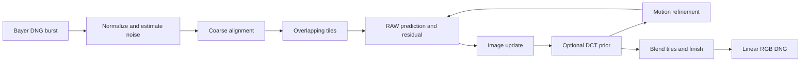

# LK-Reloaded Super-Resolution

[Paper](https://arxiv.org/abs/2104.06191) ·
[Authors' project and results](https://bruno-31.github.io/lkburst2/index.html) ·
[Method explained](docs/METHOD.md) · [All CLI options](docs/CLI.md) ·
[Resources and datasets](docs/RESOURCES.md) · [Diagnostics](docs/VALIDATION.md)

Turn a handheld burst of Bayer RAW photographs into one cleaner, demosaiced
image, optionally at twice the width and height. The result is a camera-linear
RGB DNG that you can develop in a RAW editor.

This is the Vulkan implementation used by [RawLens](https://github.com/matthew777777/RawLens),
based on Lecouat, Ponce and Mairal's
[Lucas-Kanade Reloaded: End-to-End Super-Resolution from Raw Image Bursts](https://arxiv.org/abs/2104.06191)
(ICCV 2021). It combines iterative image reconstruction with motion refinement.
It uses no downloaded neural-network weights; an optional sliding-DCT prior is
available. See the [technical notes](tools/lkr-pipeline/README.md) for differences
from the paper and historical parity measurements.

## Quick start

Requirements: CMake 3.22.1+, Clang with C++17 support, a JDK (JNI headers),
`glslc`, and a Vulkan 1.1-capable GPU/driver. macOS uses MoltenVK.
The current shared CMake uses Clang's thin LTO in Release builds.

### macOS

Install Xcode Command Line Tools if you do not already have a compiler:

```sh
xcode-select --install
```

With [Homebrew](https://brew.sh) installed:

```sh
git clone https://github.com/matthew777777/LK-Reloaded-Super-Resolution.git
cd LK-Reloaded-Super-Resolution
brew install cmake ninja shaderc vulkan-headers vulkan-loader molten-vk openjdk
./build.sh
./run.sh ./burst ./merged.dng --s 2
```

`build.sh` finds Homebrew's JDK if no system JDK is registered. You can also set
`JAVA_HOME` yourself. If Vulkan cannot find MoltenVK, set `VK_ICD_FILENAMES` to
your installation's `MoltenVK_icd.json`.

### Ubuntu / Debian

Install the dependencies and your GPU vendor's Vulkan driver:

```sh
sudo apt update
sudo apt install clang cmake ninja-build glslc libvulkan-dev default-jdk
git clone https://github.com/matthew777777/LK-Reloaded-Super-Resolution.git
cd LK-Reloaded-Super-Resolution
CC=clang CXX=clang++ ./build.sh
./run.sh ./burst ./merged.dng --s 2
```

macOS is locally validated. A Linux build job is included in CI;
its execution status is visible in GitHub Actions. GPU execution depends on your driver. Windows is not currently supported
by these scripts.

## Prepare a burst

Put photographs of the same scene in one folder:

```text
burst/
  0001.dng
  0002.dng
  0003.dng
  ...
```

Use Bayer CFA DNGs from the same camera, at matching dimensions and exposure.
Small handheld shifts provide the extra sampling for super-resolution. Moving
subjects and clipped highlights can limit the result. Start with 8–16 frames.
Use zero-padded names: files are read in alphabetical order and the first is the
reference. The current executable recognizes lowercase `.dng` filenames.
Camera JPEGs, proprietary RAW formats, and `.craw` containers must be converted
or extracted to supported Bayer DNGs first. There is no built-in CRAW importer.

## Examples

```sh
# Merge at the original dimensions (also the default).
./run.sh ./burst ./clean.dng --s 1

# Twice the width and height: four times the pixel count.
./run.sh ./burst ./large.dng --s 2

# A faster first look: use eight frames and a 512 × 512 sensor crop.
./run.sh ./burst ./preview.dng --s 2 --frames 8 --crop 512 512

# Enable the optional DCT prior (disabled by the desktop CLI by default).
./run.sh ./burst ./denoised.dng --s 2 --prior 1

# Use fewer concurrent tile workers to reduce working memory.
./run.sh ./burst ./merged.dng --s 2 --workers 1
```

The output is linear RGB, so open it in a RAW editor to adjust exposure, white
balance and tone. This project does not produce a finished, tone-mapped JPEG.
Full-resolution bursts can use substantial RAM and GPU memory; try a crop first.

`./run.sh --help` shows the basic syntax. Expert options are documented in the
[technical notes](tools/lkr-pipeline/README.md) and
[CLI source](tools/lkr-pipeline/host/lkr_full_run.cpp).

## Check the build

```sh
ctest --test-dir build --output-on-failure
```

The colour guard check runs on the CPU; the robustness check requires a
working Vulkan device. `lkr_mhc_check` is a separate CPU parity tool requiring
input pixels, metadata and an output path, rather than a self-contained test.
Python is only needed for optional diagnostics; install
NumPy and Pillow to use `tools/lkr-pipeline/inspect_trace.py`. Python reference
experiments mentioned in the technical notes live in RawLens and are not part
of this standalone repository.

## Identical to RawLens, easy to sync

The pipeline, shaders, shared Vulkan/DNG code and TinyDNG files are copied
without transformations. Their original paths let both projects use the same
CMake files. The `app/` folder here contains only the TinyDNG dependency, not an
Android application. You do not need to clone RawLens to build this repository.

To refresh this checkout, run from your separate RawLens checkout:

```sh
python3 tools/lkr-standalone/sync.py /path/to/LK-Reloaded-Super-Resolution
python3 tools/lkr-standalone/sync.py /path/to/LK-Reloaded-Super-Resolution --check
```

`--check` compares every managed file byte-for-byte using SHA-256, including
packaging files. `.rawlens-standalone.json` records hashes and the RawLens base
commit; it explicitly records that local working-tree changes may be included.
Make shared code changes in RawLens, then sync. If you edited this checkout,
copy those changes back to matching RawLens paths first; sync refuses to
overwrite local edits. New source files must be added to RawLens Git first.
Build artifacts and photographs are never synced.

## How it works

The solver starts with an estimate of the reference view, predicts what each
RAW frame should have measured, and uses the difference to improve both the
image and alignment. Bayer sampling, pixel integration and subpixel motion
are represented in that prediction. Reconstruction, denoising and demosaicing
therefore share the same image estimate rather than being independent exports.



This is an independent production implementation based on the ICCV 2021 paper,
with deterministic parameter schedules and RawLens-specific robustness and
finishing. The paper's learned ResUNet, learned schedule, training pipeline,
and reported benchmark scores are not reproduced by this desktop package.
The [method guide](docs/METHOD.md) maps the implementation to equations and files,
and explains the optional `--paper 1` ablation.

## Documentation

| Guide | Contents |
| --- | --- |
| [Method](docs/METHOD.md) | Forward model, HQS, image and motion updates, noise, robustness, implementation differences |
| [CLI](docs/CLI.md) | Every accepted option, current defaults, interactions, output formats |
| [Resources](docs/RESOURCES.md) | Paper, supplementary material, viewers, related methods, source and dataset links |
| [Validation](docs/VALIDATION.md) | Tests, traces, held-out frames, fair comparisons, historical parity |
| [Troubleshooting](docs/TROUBLESHOOTING.md) | Build, GPU, input, memory and image-quality issues |
| [Contributing](CONTRIBUTING.md) | Keep copied sources identical and submit reproducible changes |

## Citation

If you use the underlying method in research, cite the original authors:

```bibtex
@inproceedings{lecouat2021lucas,
  title = {Lucas-Kanade Reloaded: End-to-End Super-Resolution from Raw Image Bursts},
  author = {Lecouat, Bruno and Ponce, Jean and Mairal, Julien},
  booktitle = {Proceedings of the IEEE/CVF International Conference on Computer Vision},
  year = {2021},
  pages = {2370--2379}
}
```

For experiments with this implementation, also record the repository commit,
sync manifest, command, input frame list and hardware. The underlying paper is
by Lecouat, Ponce and Mairal; this repository documents the RawLens port and
its extensions. See [CITATION.cff](CITATION.cff).

## License

The LK-Reloaded pipeline and shared RawLens support code are licensed under
[Apache 2.0](LICENSE). See [NOTICE](NOTICE). TinyDNG retains its
[MIT license](app/src/main/cpp/deps/tinydng/LICENSE); additional dependency notices
are kept beside the sources. RawLens's overall application license is separate.
